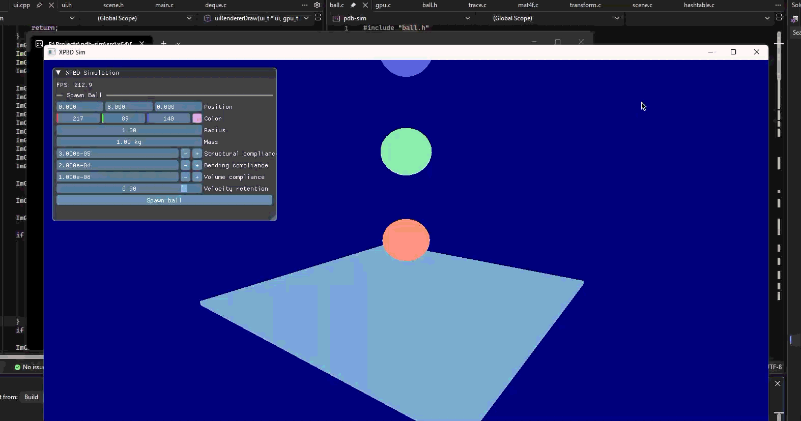

# XPBD Simulation

A simulation for XPBD: Position-Based Simulation of Compliant Constrained Dynamics.

<div align="center">
  
</div>

Inspired by: https://matthias-research.github.io/pages/publications/XPBD.pdf

This system includes various game engine support for ease of usability.

## What it simulates

- **Soft balls**: closed particle shells held by stretch and bending springs plus a volume constraint, so they squash and bounce but keep their volume.
- **Cloth**: square sheets with stretch, shear and bending constraints, self-collision and double-sided rendering with a closed rim. Sheets can fall free, be pinned at the corners, along one edge (a banner) or around the whole border (a trampoline).
- **Solid spheres**: static, smooth sphere colliders (not soft bodies) for cloth to fall onto and drape over.
- **Contacts**: one XPBD contact model for particle-particle and particle-ground contact, with static and dynamic friction, restitution and rolling resistance.

The solver follows Macklin et al., "Small Steps in Physics Simulation" (2019) and "Detailed Rigid Body Simulation with Extended Position Based Dynamics" (2020): each frame is split into 8 substeps, each solved in two passes (one is not enough for resting stacks such as cloth folded on the ground, which then vibrates), contacts are found once per frame with a spatial hash and solved every substep, and a velocity pass applies friction and restitution. Damping removes only deformation, so falling, rolling and spinning are preserved.

## Editor and play mode

The app works like a game-engine scene editor. It starts with an empty scene in **Edit** mode, where nothing simulates:

- **Hierarchy** (left): add a ball, a cloth or a solid sphere, load the trampoline or drape demo, clear the scene, and pick objects from the list.
- **Inspector** (right): edit the selected object's position, colour, mass, size and solver settings, and its material (texture and texture scale). Each change rebuilds that object.
- **Environment** (left, below the hierarchy): turn the sky on or off, set its exposure and rotation, and pick the ground's texture. These are scene settings, so Stop leaves them as they are.
- **Simulation** (top): Play, Pause, Step and Stop, the Edit-mode tool, timings and the solver settings.

Edit mode has two tools:

- **Move**: the selected object shows a gizmo with red, green and blue handles. Drag a handle to move the object along X, Y or Z only.
- **Pin cloth**: click a point on a cloth to pin it in place (click it again to unpin). Pinned points are drawn dark and stay fixed while playing. Pins add to the cloth's pin preset (corners, edge, border); the inspector shows the count and can clear the hand-placed ones.

**Play** starts the simulation from the authored scene. Objects can still be added, grabbed and deleted while playing, but those are runtime changes: **Stop** returns to Edit mode and rebuilds the scene exactly as it was before Play. The inspector is read-only while playing.

| Input | Edit mode | Play mode |
| --- | --- | --- |
| Left click | Select the object under the cursor (empty space deselects); with Pin cloth, pin or unpin a cloth point | Select |
| Left-drag on a gizmo handle | Move the selection along that axis | — |
| Right-drag | Move the object under the cursor | Grab and drag it physically |
| Delete | Delete the selection | Delete it until Stop |
| Left-drag | Orbit the camera | Same |
| Mouse wheel | Zoom | Same |

## Textures and sky

Textures live in `src/textures/` and are loaded once at startup by the texture library (`texture_library.c`), like the shaders: files are read through `fs` and decoded with [stb_image](https://github.com/nothings/stb) (`lib/stb/`). The library holds grass, rock and snow (from the Terrain Generator project), a generated checker, and the sky panorama. A texture that fails to load is skipped with a warning, and objects that use it render untextured.

Every lit mesh uses one vertex layout (`gpu_vertex_t`: position, normal, colour, uv) and the `pbr` shader, which multiplies the vertex colour, the object's colour and its texture. The renderer creates each texture on the GPU the first time a draw uses it (uploaded through a staging buffer, with a full mip chain) and binds a 1x1 white texture for untextured draws. Balls get longitude/latitude uvs, with extra render vertices along the seam and at the poles so no triangle stretches across the texture; cloth spans its texture once and uses the checker by default.

The sky is an equirectangular (2:1) panorama drawn on a cube around the camera by the `skybox` shader, adapted from the Terrain Generator: it sits on the far plane (`clip.xyww`, depth test `LEQUAL`, no depth writes) and crossfades the panorama's seam. The scene renders with 4x MSAA where the GPU supports it, so cloth hems and silhouettes are not stair-stepped.

## Containers

- `deque.h`: a fixed-capacity, blocking, thread-safe queue (the render queue, file and trace queues). Slots are a power of two indexed by masked running counters, so it stays correct when they wrap.
- `hashtable.h`: a hash table from 64-bit keys to 64-bit values, with open addressing, linear probing, growth at half full and backward-shift removal, plus a key for unordered id pairs.

Contact detection's pair search runs on the physics worker threads: each takes a contiguous run of grid candidates and writes its pairs to its own buffer, and the buffers are appended in order, so the contacts (and the simulation) are exactly those of a serial search.

## Building and testing

Open `src/pdb-sim.sln` in Visual Studio 2022 or later, or build from a developer prompt:

```
msbuild src/pdb-sim.vcxproj -p:Configuration=Release -p:Platform=x64
```

The compiled shaders (`src/shaders/*.spv`) are checked in. After editing a `.vert` or `.frag` file, run `src/shaders/compile.bat`, which needs [glslang](https://github.com/KhronosGroup/glslang/releases) (`glslang.exe`, or `glslangValidator.exe` from the Vulkan SDK) on the PATH or in the `GLSLANG` environment variable.

Run from `src/` so the shaders and textures are found. Command-line options:

- `pdb-sim.exe --test` runs the container and physics regression tests headless and exits with the number of failures.
- `pdb-sim.exe --bench` times four physics scenes (the drape, the trampoline demo, a pile of 16 balls, a 64x64 sheet) for ten simulated seconds each and prints the average milliseconds per frame for each phase of the step (contact detection, constraints, contacts, integration, velocity pass, damping). `physicsGetProfile` returns the same split for the last frame.
- `pdb-sim.exe --smoke` runs the editor with scripted input (add objects, click to select, play, grab, delete and add during play, pause, step, stop, move and edit in edit mode, load the demo, pick textures, hide the sky) and checks after each step, including that Stop restores every particle exactly. It exits with the number of failed checks.
- `pdb-sim.exe --demo` opens the editor with the demo scene loaded.
- `pdb-sim.exe --drape` opens the drape demo and starts playing it.
